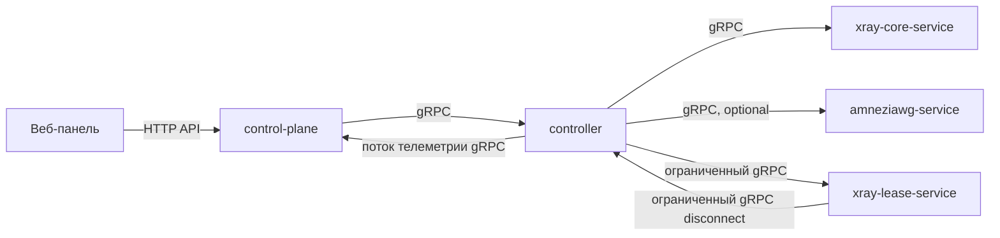

# Критическое ревью backend-сервисов — 5 октября 2026

## Область ревью

Проверены Compose-топология, точки запуска Go-сервисов, HTTP/gRPC API,
телеметрия Xray, enforcement source leases, SQLite-хранилище и остановка
процессов. `amneziawg-service` и `xray-lease-service` рассматриваются как
необязательные сервисы из Compose-профилей.

Правило границ: HTTP API control-plane обслуживает веб-панель. Все вызовы между
сервисами выполняются через gRPC. Проверка контейнерного процесса может быть
локальной и не считается межсервисным API.

## Схема взаимодействия

## Находки

### P1 — legacy-профиль с VLESS и Hysteria терял lease-телеметрию

У `legacy_dual` один Xray email используется двумя протоколами. Runtime
индексировал наблюдения по email и перезаписывал протокол при обходе map. Если
последним оказывался Hysteria 2, Controller отбрасывал запись для lease API, и
активные VLESS source leases исчезали из снимков. При включённом lease-сервисе
это могло обходить ограничение числа исходных IP.

Исправление: при одинаковом email протокол выбирается детерминированно, с
приоритетом поддерживаемого lease-протокола; агрегированная строка трафика
остаётся одна. Добавлена регрессионная проверка.

Доказательства: [client.go](../internal/domain/client.go:130),
[render.go](../internal/xray/render.go:570),
[engine.go](../xray-runtime/internal/runtime/engine.go:537),
[telemetry_hub.go](../internal/controller/telemetry_hub.go:256).

### P1 — внутренняя HTTP-проверка lease-сервиса нарушала границу протоколов

До исправления control-plane обращался к `/healthz` lease-сервиса по HTTP, а
lease-контейнер использовал тот же endpoint. Это был межсервисный вызов вне
gRPC-контракта. Endpoint мог сообщить об успехе до получения пригодного полного
снимка, а клиент не учитывал поле `ready`.

Исправление: lease-сервис публикует стандартный gRPC health API. Он сообщает
`SERVING` только после появления пригодной телеметрии. Doctor и контейнерная
проверка используют gRPC. HTTP control-plane остаётся интерфейсом панели.

### P2 — остановка сервисов могла ждать бесконечно или не закрывать ресурсы

Controller и AWG вызывали `GracefulStop()` без срока, хотя их stream RPC могут
оставаться открытыми. Control-plane не обрабатывал SIGTERM и не вызывал HTTP
`Shutdown`, отмену и join фоновых workers.

Исправление: gRPC-сервисы дают активным RPC ограниченное время, затем выполняют
принудительную остановку. Control-plane обрабатывает SIGINT/SIGTERM, завершает
HTTP-сервер по deadline и закрывает активные соединения при превышении срока;
его workers отменяются и ожидаются через существующий cleanup.

### P2 — первичная настройка могла фиксироваться частично

Раньше Store сохранял администратора и базовые настройки в одной транзакции, а
HTTP handler затем отдельно читал и обновлял REALITY/Xray settings. Ошибку
чтения настроек handler игнорировал и возвращал `201`; ошибку обновления отдавал
после фиксации администратора. Повтор setup в таком состоянии уже конфликтовал.

Исправление: полная запись администратора и настроек выполняется одной
транзакцией. Тест проверяет, что ошибка вставки настроек не оставляет setup
инициализированным.

### P2 — unary polling дублировал активный telemetry stream

Stats worker вызывал unary `Poll` каждые 10 секунд даже при активном потоке
полных снимков. Оба пути повторно читали данные runtime и SQLite.

Исправление: периодический unary poll сохраняется как fallback без активного
потока; при подключённом stream он подавляется и возобновляется после обрыва.
Counters runtime хранятся в памяти процесса: при перезапуске до durable
checkpoint остаётся окно потери незафиксированной дельты. При stream-подписчике
checkpoint обновляется по потоку; без подписчика окно ограничено следующим
poll (обычно до 10 секунд).

### P2 — ошибка необязательного AWG adapter мешала запуску Controller

При заданном `AWG_PUBLIC_HOST` ошибка загрузки AWG adapter прерывала запуск
Controller, хотя Xray API мог работать независимо.

Исправление: Controller запускается без adapter и пишет причину в журнал.
Попытки вызвать недоступную AWG-функцию остаются видимыми через gRPC-ошибку и
Doctor.

### P2 — отсутствовали ограничения попыток входа и параллельного Argon2

Каждая попытка входа могла запустить Argon2id-проверку с расходом 64 MiB и
несколькими проходами. Явного лимита по адресу клиента и предела параллельных
проверок не было.

Исправление: для login/TOTP/recovery применяется ограничение числа запросов от
одного сетевого источника и конечный пул проверки пароля. При превышении
возвращается HTTP 429 с `Retry-After`. X-Forwarded-For не используется как
доверенный источник адреса.

### P3 — дублирование маршрутизации протоколов усложняет расширение

`cmd/xray-easy/main.go` содержит крупный HTTP entrypoint, а add/list/remove
протокольные маршруты повторяют dispatch по типам адаптеров и Controller. Это
повышает цену следующего протокола, но широкая перестройка не нужна для
исправления границы gRPC и может менять поведение.

Решение: вынести безопасный behavior-preserving рефакторинг в отдельную задачу;
не смешивать его с исправлениями жизненного цикла и протокольной границы.

Доказательства: [main.go](../cmd/xray-easy/main.go:112),
[service.go](../internal/controller/service.go:353),
[embedded_xray.go](../internal/controller/embedded_xray.go:293),
[controller.proto](../internal/controller/api/v1/controller.proto:24).

## Результат по сервисам

| Сервис | Результат ревью и действие |
| --- | --- |
| `control-plane` | HTTP используется панелью; исправлены atomic setup, SIGTERM/HTTP shutdown, дублирующий poll и throttling пароля. Структурный рефакторинг dispatch оставлен отдельной задачей. |
| `controller` | Приватная gRPC-граница и scoped lease identity сохранены; добавлена ограниченная остановка и деградация при недоступном необязательном AWG adapter. |
| `xray-core-service` | Исправлен выбор протокола для legacy dual email, чтобы lease observations не терялись. |
| `xray-lease-service` | HTTP health заменён стандартным gRPC health; readiness зависит от полного пригодного снимка. Fail-open enforcement при недоступной телеметрии сохраняется. |
| `amneziawg-service` | Отдельный необязательный gRPC-процесс; остановка stream RPC ограничена deadline. |
| Init-контейнеры | Одноразовая настройка token/volume/TLS; межсервисных HTTP API не обнаружено. |

## Ограничения

Внутренние приложения вызывают друг друга по gRPC. HTTP `/api/...` control-plane
предназначен для панели. Локальная Docker-проверка собственного
`control-plane/api/healthz` проверяет только сам контейнер и не является
межсервисным вызовом. Сетевую сегментацию и scope токенов следует сохранять.

Покрытие и полный тестовый результат зафиксированы в
[плане исправления](backend-services-remediation-plan.md).
