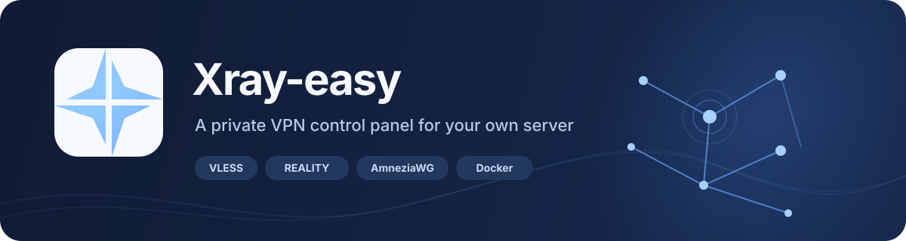
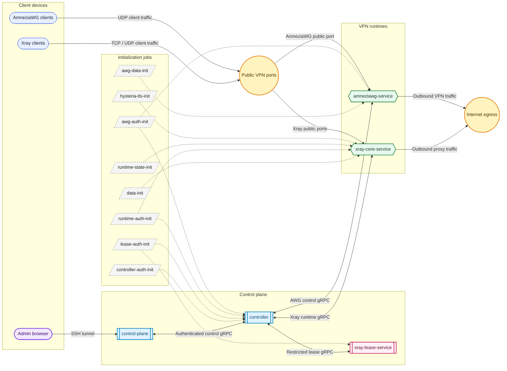

# Xray-easy — Português (Brasil)

<a href="../../../README.md">English</a> · <a href="../ru/README.md">Русский</a> · <a href="../de/README.md">Deutsch</a> · <a href="../es/README.md">Español</a> · <strong>Português (Brasil)</strong> · <a href="../fr/README.md">Français</a> · <a href="../tr/README.md">Türkçe</a> · <a href="../fa/README.md">فارسی</a> · <a href="../ar/README.md">العربية</a> · <a href="../zh-CN/README.md">简体中文</a> · <a href="../uk/README.md">Українська</a> · <a href="../pl/README.md">Polski</a>

  

  

  
<strong>VPN auto-hospedada, gerenciada por um painel web privado.</strong> 
  Monte no seu VPS, abra o painel por SSH e crie perfis de cliente sem editar configurações do Xray manualmente.

Xray-easy é uma aplicação Docker Compose para um administrador e um servidor. Ela combina Xray e AmneziaWG opcional com uma interface web para configuração, perfis de dispositivos, diagnóstico e manutenção. O painel escuta no loopback do VPS e deve ser acessado por um túnel SSH.

## Contents

- [Quick start](#quick-start)
- [Docker services](#docker-services)
- [Ports and firewall](#ports-and-firewall)
- [Protocol guide: Xray](#protocol-guide-xray)
- [Protocol guide: AmneziaWG](#protocol-guide-amneziawg)
- [Operations and troubleshooting](#operations-and-troubleshooting)
- [Security and architecture](#security-and-architecture)
- [Development](#development)

## Quick start

### Requirements

- Linux VPS with an **amd64** or **arm64** CPU and SSH access.
- Docker Engine **28.0.0+** and Docker Compose plugin **2.33.1+**.
- A public IPv4 address or DNS name. IPv6 can also be used when the VPS,
  Docker and firewall have working IPv6 routing.
- An available public TCP port, **443** by default.

The VPS needs outbound network access to download images and carry VPN traffic.
Go and Node.js are not required on the VPS. The installer normally pulls its
prebuilt installer and service images from GitHub Container Registry (GHCR).
If GHCR cannot provide them, it builds the installer and services locally from
this checkout.

### 1. Clone and install

Run these commands on the VPS:

~~~sh
git clone https://github.com/dasshit/xray-easy.git
cd xray-easy
./install.sh
~~~

The installer opens a full-screen terminal wizard. It checks Docker, guides
you through the public and panel ports, optional Hysteria 2 TLS and optional
AmneziaWG and optional Xray source-IP lease enforcement, then creates the
secrets, pulls the service images, starts Compose and runs the final health
check. Lease enforcement is off by default and can be enabled in the wizard. Use **↑/↓** or **Tab** to move, **Enter** to
continue, **Esc** to cancel and **Ctrl+C** to stop. If pulling the installer
image fails, `install.sh` builds that image locally. If pulling service images
fails, the wizard builds the services locally from this checkout.
Local builds still need their base images and Go dependencies from an available
registry or the Docker/Go caches; the fallback cannot bootstrap a fresh host
while all registry access is unavailable.

Pushing a `v*` tag runs the tested GHCR publication workflow for
**amd64** and **arm64**. If a service does not become healthy, the installer
keeps the configuration for troubleshooting and prints recent logs and
recovery commands. It reuses existing keys and Docker volumes on repeat runs.

### 2. Open the panel through SSH

Keep this command running on your own computer. Replace the SSH user, VPS host
and port if you chose a panel port other than 8080:

~~~sh
ssh -N -L 8080:127.0.0.1:8080 user@your-vps
~~~

Then open [http://127.0.0.1:8080](http://127.0.0.1:8080) in a browser. The panel
is bound to **127.0.0.1 on the VPS**; do not expose its port in a public
firewall or reverse proxy.

### 3. Finish first-run setup

In the panel:

1. Create the administrator login and password.
2. Set the public host clients will use: the VPS IPv4, IPv6, or a DNS name.
   For dual-stack DNS, configure working A and AAAA records.
3. Choose the REALITY target and SNI for the default VLESS profile.
4. Create the first device and select its protocol.
5. Scan the QR code or download/copy the profile into the matching client.

The installer configures deployment-wide values such as public ports. The
panel manages protocol settings and individual devices. Enable TOTP from the
Security page after the first login.

## Docker services

Compose separates the public control plane from the VPN runtimes. The runtime
gRPC endpoints, Controller, and optional lease policy service are reachable
only on private Docker networks; the only published application port is the Web
UI on the VPS loopback interface. `amneziawg-service` is started only with the
`awg` Compose profile. `xray-lease-service` is off by default and starts with
the `lease` profile when selected in the installer. The administrator's browser reaches the panel through an
SSH tunnel, while VPN client devices use the public Xray or AmneziaWG ports.

Rounded nodes are client devices, double-bordered nodes are control services,
hexagons are VPN runtimes, slanted nodes are one-shot initialization jobs, and
yellow circles are public or external network boundaries. Dashed arrows show
bootstrap dependencies; solid arrows show runtime traffic or control calls.

| Service | Responsibility |
| --- | --- |
| `control-plane` | Serves the authenticated Web UI and HTTP API, stores devices and settings in SQLite, prepares Xray configuration, and forwards management and telemetry calls through the Controller. Its port is bound to the VPS loopback interface. |
| `controller` | Internal protocol adapter. It exposes the stable application gRPC contract, validates revisions, routes commands to the embedded Xray runtime and optional AmneziaWG service, and aggregates health, statistics and telemetry. |
| `xray-lease-service` | Optional source-IP sharing policy for VLESS, VMess and Trojan. It consumes full Controller snapshots and can request an exact TCP source-lease disconnect through a lease-only gRPC identity. Enable it with the `lease` Compose profile. |
| `xray-core-service` | Runs the pinned Xray-core version inside the embedded runtime, serves Xray's management APIs through the runtime wrapper, applies active configuration revisions, and carries VLESS, VMess, Hysteria 2, Shadowsocks and Trojan traffic. |
| `amneziawg-service` | Optional AmneziaWG engine. It owns the TUN interface, peer lifecycle and WireGuard telemetry. Enable it with the `awg` Compose profile. |
| `hysteria-tls-init` | One-shot certificate preparation job. It creates or copies the Hysteria 2 certificate into the shared volume before Xray starts. |
| `data-init` | Creates the shared application/configuration directories and installs the initial Xray configuration. |
| `runtime-auth-init` | Generates and protects the token used to authenticate calls to the Xray runtime. |
| `runtime-state-init` | Creates the runtime state directory used to persist the applied configuration revision. |
| `controller-auth-init` | Generates and protects the token used by the control plane and Controller gRPC clients. |
| `lease-auth-init` | Generates a separate token restricted to lease snapshots and exact lease disconnects. |
| `awg-auth-init` | Generates and protects the token used for Controller-to-AmneziaWG gRPC calls. It also runs when AWG is disabled so the main stack has a consistent dependency graph. |
| `awg-data-init` | Optional one-shot job that prepares ownership and permissions for the persistent AmneziaWG data volume. |

The `*-init` services exit successfully after preparing shared volumes; they
are not long-running daemons. Compose health checks then gate startup in the
order shown above. All services use journald logging, so the stack can be
inspected with `docker compose logs --since=3h`.

## Ports and firewall

Allow only the ports for transports you use. Apply the rules in both the VPS
firewall and the provider security group, for IPv4 and IPv6 where enabled.

| Transport | Default public port | Protocol | Notes |
| --- | ---: | --- | --- |
| VLESS + REALITY | 443 | TCP | Default Xray profile |
| Hysteria 2 | 443 | UDP | Optional; shares the public port number with VLESS |
| VMess + TLS | 9443 | TCP | Optional separate Xray inbound |
| Shadowsocks | 8388 | TCP and UDP | Optional Shadowsocks 2022 multi-user inbound |
| Trojan + TLS | 10443 | TCP | Optional inbound using the VMess TLS certificate |
| AmneziaWG | 1234 | UDP | Optional separate service |
| Web UI | 8080 | TCP, loopback only | Reach through SSH; never open publicly |

Ports are configurable during installation and stored in the root **.env**
file. Xray uses **XRAY_PUBLIC_PORT** for VLESS TCP and optional Hysteria 2 UDP,
**XRAY_VMESS_PORT** for VMess TCP, **XRAY_SHADOWSOCKS_PORT** for Shadowsocks
TCP and UDP, and **XRAY_TROJAN_PORT** for Trojan TCP. AmneziaWG uses
**AWG_PUBLIC_PORT**.

## Protocol guide: Xray

The `xray-core-service` container embeds Xray-core as a Go library. The project
pins Xray **26.7.28** as the currently verified version for its API integration
and VLESS + REALITY profile workflow.
The UI and doctor report when the configured or running version differs from
the verified compatibility record at
[../../../versions/xray-compatibility.json](../../../versions/xray-compatibility.json). Treat
other versions as experimental until tested with your clients.

| Profile type | Transport and security | Profile delivery |
| --- | --- | --- |
| VLESS | TCP/RAW + REALITY + XTLS Vision | QR, VLESS link, JSON |
| Hysteria 2 | UDP + TLS | QR, hysteria2 link |
| Trojan | TCP + TLS | QR, trojan link, JSON |
| VMess | TCP + TLS, alterId 0 | QR, vmess link, JSON |
| Shadowsocks | TCP/UDP + Shadowsocks 2022 | QR, ss link, JSON |
| Trojan | TCP + TLS | QR, trojan link, JSON |

Each new profile uses one protocol. To give one device multiple transports,
create a separate profile for each one with the same device name.

### VLESS + REALITY

This is the default protocol. New clients are added live through Xray's
HandlerService while one of five reserved REALITY short IDs is available.
When the reserve is exhausted, Xray replaces the VLESS inbound; its active
connections may briefly reconnect. The UI validates and previews sensitive
settings changes before applying them and creates an automatic backup where
needed.

Changing the REALITY key, target or SNI can invalidate issued profiles. Follow
the warning in the panel and re-import refreshed profiles on clients. Xray
log verbosity is managed separately in Settings; debug logs are verbose, so
return to warning after troubleshooting.

### Hysteria 2

Hysteria 2 runs as an optional UDP inbound in the same Xray container. Enable
it during installation or later from **Settings → Hysteria 2**. Its profiles
have an independent password and are available once the inbound and TLS
certificate are ready.

The TLS setup supports two modes:

- **mkcert certificate:** the installer generates a certificate for a
  public IPv4 address. Generated client links use **insecure=1**. This lets
  clients connect but disables server certificate verification, so the client
  does not authenticate the server against a man-in-the-middle.
- **Custom certificate:** provide a matching PEM full chain and private key.
  Use a certificate trusted by clients and whose name matches the endpoint or
  configured SNI. Links use normal certificate verification.

The panel can enable/disable the inbound, update TLS and transport settings,
and replace certificates. Applying changes may briefly reconnect Hysteria 2
clients; VLESS remains running. Allow inbound UDP on the configured Xray
public port.

### VMess + TLS

VMess uses a separate TCP port, **9443** by default. It reuses the certificate
managed under **Settings → Hysteria 2**, even if the Hysteria 2 inbound is
disabled. Configure that certificate before creating a VMess profile.

For self-signed or legacy certificates, the generated VMess link pins the
certificate fingerprint and the downloadable Xray JSON uses
**pinnedPeerCertSha256**. Client and server clocks should be within about two
minutes. Re-import profiles after replacing the certificate. VMess is provided
for compatibility and is easier to identify by traffic analysis than VLESS +
REALITY or Hysteria 2; it is not presented as a DPI-resistance improvement.

### Shadowsocks

Shadowsocks uses an optional **Shadowsocks 2022 multi-user inbound** in the
embedded Xray runtime. Enable it during installation with
**XRAY_SHADOWSOCKS_ENABLED=true**, then choose its public port and network in
the installer or `.env`. The cipher is fixed to
`2022-blake3-aes-256-gcm`:

~~~dotenv
XRAY_SHADOWSOCKS_ENABLED=true
XRAY_SHADOWSOCKS_PORT=8388
XRAY_SHADOWSOCKS_METHOD=2022-blake3-aes-256-gcm
XRAY_SHADOWSOCKS_NETWORK=tcp,udp
~~~

The installation server key is derived from **XRAY_EASY_MASTER_KEY**. Each
device receives its own random 32-byte user key, encrypted at rest and shown
only in its authenticated profile delivery. Profiles include an `ss://` link,
QR code, and Xray JSON. Use a client that explicitly supports the selected
Shadowsocks 2022 method; v2RAGE does not currently list Shadowsocks.

This changes the wire format: classic Shadowsocks profiles stop working after
upgrading and must be re-imported from the panel. Stored device key bytes are
preserved during migration. Xray-easy can add, disable, enable, and revoke
users through the embedded runtime without replacing the inbound. SS2022
improves replay protection, but does not provide REALITY camouflage or TLS
forward secrecy.

The listener uses one port number in two socket namespaces, so TCP and UDP can
share **XRAY_SHADOWSOCKS_PORT**. It cannot share a TCP port with VLESS/VMess or
an UDP port with Hysteria 2. Open both TCP and UDP for the configured port when
both networks are enabled.

### Trojan + TLS

Trojan is an optional TCP/TLS inbound in the embedded Xray runtime. Enable it
with **XRAY_TROJAN_ENABLED=true** and choose **XRAY_TROJAN_PORT** (10443 by
default). It shares the certificate and SNI configured under **Settings →
Hysteria 2**. Each device receives a unique encrypted password and the panel
provides a `trojan://` link, QR code and JSON profile. Self-signed or legacy certificates use the Xray-standard `pcs` SHA-256
certificate pin in links and `pinnedPeerCertSha256` in JSON; trusted certificates
keep normal TLS verification. `allowInsecure` is not exported. Users are added and removed through the
live HandlerService when the inbound is already running.

### Xray source-IP lease policy

The optional `xray-lease-service` detects profile sharing by source IP. It
currently applies only to VLESS, VMess and Trojan TCP connections, where the
runtime can close the exact authenticated connection without revoking the
profile. Hysteria 2, Shadowsocks and AmneziaWG are not affected.

One profile may have two active source-IP leases. When a second source appears,
both are allowed for 30 seconds; if both remain, the oldest lease is closed. A
third source closes the oldest immediately and keeps the two newer leases. This
is network-source tracking, not device identity: two devices behind the same
NAT appear as one lease, while one device switching networks can appear as two.

The 15-second offline window is currently measured per profile by Xray traffic
counters. Xray does not expose a separate per-source traffic clock, so an idle
source whose connection remains open can stay listed while another source for
the same profile continues to send traffic.

### Xray status and troubleshooting

Profiles show online/last-seen state, cumulative upload/download, current
upload/download rates and the last observed source IP when the protocol reports
it. While the authenticated Web UI is open, Xray and AmneziaWG publish telemetry
through a shared gRPC stream about once per second, which the existing SSE
connection forwards to the page. A client is online while its user-data
counters have advanced within the last 15 seconds; an idle open tunnel does not
keep it online. The optional lease policy uses the same profile-level online
window to remove source observations after traffic stops. When no Web UI SSE clients are connected, the backend keeps its
10-second poll to continue saving traffic totals in SQLite. If a VPN service
restarts between polls while the UI is closed, traffic since the previous poll
can be lost because service counters are process-local.

Run the doctor from the VPS repository directory:

~~~sh
docker compose exec -T control-plane xray-easy doctor
~~~

It checks configuration, runtime/API availability, version compatibility and
network prerequisites. It cannot test inbound firewall reachability from
inside Compose; verify public ports from another network. For IPv6-specific
checks, see [IPv6 verification](#ipv6-verification).

## Protocol guide: AmneziaWG

AmneziaWG is an optional independent service, not an Xray inbound. Enable it
in the installer and enter the public IP or DNS name clients will connect to.
It appears in the shared **Profiles** workflow alongside Xray protocols and
in **Settings** as a read-only summary of the active endpoint, ports, address
pools, peer count, server public key and service version.

The service requires a **Linux Docker host**, **/dev/net/tun**, the
**NET_ADMIN** capability, IPv4 and IPv6 forwarding, and working egress for both
address families. Rootless Docker or host policies that block TUN access may
prevent startup. The default public UDP port is **1234**; the internal listen
port is **51820**. Allow the public port in the VPS and provider firewalls.

Profiles include the client private key. Scan the QR code with the official
AmneziaWG client on iOS or macOS, or download the **.conf** file. Handle both
as credentials. Peer changes apply to the live engine without restarting its
container. Revoking a peer creates an automatic backup first and deletes the
saved profile from the server.

The profile list reports handshake-based online state, last seen, cumulative
and sampled traffic, plus source IP when available. These are observations
from the latest handshake, not a live socket count. The built-in AmneziaWG 3.x
obfuscation preset matches current client defaults. Advanced overrides are
available through **AWG_*** values in **.env.example**; changing shared
parameters requires refreshing and re-importing client profiles.

AmneziaWG allocates addresses from **10.88.0.0/24** and **fd88:88:88::/64** by
default, with DNS **1.1.1.1** and **2606:4700:4700::1111**. Change these
networks if they overlap routes already used by the VPS.

## Operations and troubleshooting

### Logs, status and upgrade

All Compose containers send their stdout/stderr to the host's **systemd journal**.
Run these commands from the repository directory on the VPS to inspect the last
three hours or follow new Xray messages:

~~~sh
docker compose ps
docker compose logs --since=3h
docker compose logs --since=3h -f xray-core-service
~~~

The journal can also be queried directly. For example, this shows Xray entries
from the last three hours (the container name is resolved from the active
Compose project):

~~~sh
xray_core_container=$(docker compose ps --all --format '{{.Name}}' xray-core-service)
sudo journalctl --since '3 hours ago' "CONTAINER_NAME=$xray_core_container" -o short-iso-precise
~~~

Journald rotates archived files automatically according to the host's size
limits. To persist journal data across reboots and bound its disk usage, an
administrator can add a system-wide drop-in on a Linux VPS:

~~~sh
sudo install -d -m 0755 /etc/systemd/journald.conf.d
sudo tee /etc/systemd/journald.conf.d/20-xray-easy.conf >/dev/null <<'EOF'
[Journal]
Storage=persistent
SystemMaxUse=256M
SystemMaxFileSize=32M
EOF
sudo systemctl restart systemd-journald
~~~

These journald limits apply to **all host journal entries**, not only Xray-easy.
The size limit may remove older entries sooner during high log volume; check
`sudo journalctl --disk-usage` and adjust `SystemMaxUse` for the VPS. On
Docker Desktop, use `docker compose logs --since=3h`; the journal is inside the
Docker VM and is not directly available through the macOS `journalctl` command.

To update from source, create a backup first, then pull and rerun the installer:

~~~sh
git pull
./install.sh
~~~

The installer keeps the existing **.env**, secret and Docker volumes. Keep
**XRAY_EASY_MASTER_KEY** unchanged: it encrypts the persisted Xray and
AmneziaWG server keys and is required to restore backups. The embedded runtime
currently pins Xray-core **26.7.28**; changing **XRAY_VERSION** to another value
causes the image build to stop until that embedded version has been deliberately
updated and verified.

### Backups and restore

The Security page can create a manual backup. The application also creates
automatic backups before operations such as changing Hysteria 2 settings,
rotating REALITY credentials or revoking an AmneziaWG peer. The ten newest are
kept under **/data/backups** in the persistent Docker volume. Backups are
plaintext, so protect the VPS and any exported copies. Create a manual backup
before updating the checkout.

~~~sh
docker compose exec control-plane xray-easy backup create
docker compose exec control-plane xray-easy backup list
docker compose exec control-plane xray-easy restore BACKUP_NAME RESTORE
docker compose cp control-plane:/data/backups ./backups
~~~

Replace **BACKUP_NAME** with a name from the list. Restore requires the backup
name and the confirmation word **RESTORE** as CLI arguments, validates the
snapshot, then backs up the current state before applying it. AWG data can only
be restored when AmneziaWG is enabled in Compose.

### Administrator recovery

These commands run in the control-plane container:

~~~sh
docker compose exec control-plane xray-easy admin reset-password
docker compose exec control-plane xray-easy admin reset-totp
docker compose exec control-plane xray-easy admin recovery-codes
docker compose exec control-plane xray-easy admin logout-all
~~~

Password reset prompts twice without echoing input and revokes all sessions.
Run it in an interactive terminal without **-T**. TOTP reset and recovery-code
reissue also invalidate sessions or previous codes as appropriate.

### Doctor bundle

If doctor reports a failure, create a support bundle:

~~~sh
docker compose exec -T control-plane xray-easy doctor bundle
docker compose cp control-plane:/data/diagnostics ./doctor-reports
~~~

The bundle contains the doctor report, Xray runtime status, recent Xray
logs and a redacted active config. It omits database contents, keys, tokens,
UUIDs, device names and REALITY short IDs. The selected REALITY target and SNI
remain in the report; review the archive before sharing it.

### IPv6 verification

On the VPS, check for a global IPv6 address and a default route:

~~~sh
ip -6 address show scope global
ip -6 route show default
~~~

From another IPv6-capable network, test the public Xray TCP port:

~~~sh
nc -6 -vz 2001:db8::1 443
~~~

Replace the example address and port. A successful TCP check confirms basic
reachability only; also test an actual client connection. For DNS profiles,
confirm the AAAA record points to a working endpoint. Doctor tests outbound
IPv6 connectivity from the Xray container, not public inbound reachability.

## Security and architecture

- The web panel is published only on the VPS loopback interface. Admin access
  is through SSH port forwarding, with password login and optional TOTP.
- Backend, Controller, the embedded Xray runtime and optional AmneziaWG use
  separate containers and private Compose networks. Runtime gRPC ports are not
  published to the VPS.
- Internal RPC links use authentication but are not encrypted; keep them on
  the private Docker networks and do not attach untrusted containers.
- **XRAY_EASY_MASTER_KEY** must be base64 encoding at least 32 bytes. The
  installer generates it on first run. Store it safely and keep it for the
  lifetime of the data volume.
- Backups are plaintext and include credentials needed to restore devices.
  Secure backup files and copied client profiles as secrets.
- Interaction logs correlate backend, Controller and runtime calls with a
  random request ID. They include method, result and duration, not RPC payloads
  or profiles. Xray core connection logs do not include that request ID.
- Long-running service containers use a read-only root filesystem, dropped
  Linux capabilities and `no-new-privileges`; persistent writes go only to
  their named volumes. The short-lived init jobs retain the privileges needed
  to create those volumes and secret files.
- Controller and AmneziaWG bearer tokens are generated from at least 32 random
  bytes, stored in protected files, and rejected when malformed or exposed to
  group/other users. Duplicate authorization metadata is rejected.
- Pin `XRAY_EASY_IMAGE_TAG` to a tested release (for example `v1.4.1`) in
  production instead of using the development-friendly `latest` default.
- CI runs `go vet` in every Go module and audits production web dependencies
  with `npm audit --omit=dev --audit-level=high`.

## Development

The backend, Controller, embedded Xray runtime and AmneziaWG service are Go
components; the web UI uses TypeScript, Vue and Vite. Local development tools
are not required on the VPS.

Run the root backend tests and coverage gate:

~~~sh
go test ./...
bash scripts/backend-coverage.sh
~~~

The AWG implementation and protobuf contract are separate Go modules:

~~~sh
cd awg-service && go test -race ./...
cd ../awg-contract && go test ./...
~~~

For web checks, run from **web/**:

~~~sh
npm ci
npm run lint
npm test
npm run test:coverage
npm run typecheck
npm run build
~~~

Push a version tag such as `v1.2.3` to publish the six service images and the
installer image into GitHub Container Registry. The workflow publishes one
package per component under `ghcr.io/dasshit/xray-easy/<component>` and tags it
`1.2.3`, `v1.2.3`, and `latest` after all test jobs pass. It uses the workflow's
built-in `GITHUB_TOKEN`; no separate registry credentials or publish secrets
are needed. GHCR creates new packages as private by default. After the
first successful release, change each package's visibility to **Public** in its
GitHub Packages settings so VPS installations can pull images without registry
login.
Package visibility is independent from the source repository's visibility.
The default GHCR owner is `dasshit`; set `XRAY_EASY_IMAGE_NAMESPACE` in `.env`
to use another owner with the same package layout. GHCR packages include the
Xray runtime, Controller, web backend, optional lease and AmneziaWG services,
Hysteria TLS initializer and installer:

| Compose service | GHCR image |
| --- | --- |
| `control-plane` | `ghcr.io/dasshit/xray-easy/control-plane:latest` |
| `controller` | `ghcr.io/dasshit/xray-easy/controller:latest` |
| `xray-lease-service` | `ghcr.io/dasshit/xray-easy/lease-service:latest` |
| `xray-core-service` | `ghcr.io/dasshit/xray-easy/xray-core-service:latest` |
| `amneziawg-service` | `ghcr.io/dasshit/xray-easy/amneziawg-service:latest` |
| `hysteria-tls-init` | `ghcr.io/dasshit/xray-easy/hysteria-tls-init:latest` |
| Installer helper | `ghcr.io/dasshit/xray-easy/installer:latest` |

On upgrade, `install.sh` migrates the previous generated default namespace
`xray-easy` to `dasshit`. `XRAY_EASY_IMAGE_NAMESPACE` contains the GHCR owner,
and `XRAY_EASY_IMAGE_TAG` selects the tag used by all component packages.
An explicit namespace environment variable takes precedence.

Regenerate checked-in typed protobuf bindings from the repository root with
**scripts/generate-protobuf.sh**. See
[THIRD_PARTY_NOTICES.md](../../../THIRD_PARTY_NOTICES.md) for third-party components
and licenses.
