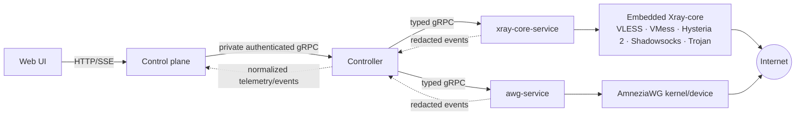

# Trojan support and runtime observability plan

Status: planned; implementation follows the commit boundaries below

## Goals

Add Trojan over TCP/TLS as a first-class Xray protocol and make runtime
behavior diagnosable without exposing secrets. The feature must reuse the
embedded Xray runtime, Controller, existing profile lifecycle, telemetry/SSE
pipeline, installer, doctor, and Web UI patterns. AmneziaWG remains a
separate protocol service and is not converted into an Xray inbound.

The work is split into two independent commits:

1. `feat(observability): add runtime and protocol service events`
2. `feat(trojan): add Trojan protocol support`

The documentation commit precedes both implementation commits. A release tag
`v1.4.0` is created only after tests and local Compose checks pass. VDS
acceptance remains a manual step after the tag is pushed.

## Decisions and scope

### Trojan MVP

- Protocol: Trojan, TCP, TLS, one shared node certificate configuration with
  the existing VMess certificate path.
- Public listener: a dedicated TCP port, default `XRAY_TROJAN_PORT=10443`.
  It cannot share a TCP socket with VLESS or VMess. The value is published by
  Compose and validated against every other host port.
- Internal listener: a fixed container port and tag `trojan-tls`.
- Credentials: one cryptographically random password per profile, encrypted
  in SQLite with `XRAY_EASY_MASTER_KEY`; plaintext exists only while rendering
  or issuing the authenticated profile response.
- Profiles: Trojan URI (`trojan://`), QR code, and JSON client config. The
  JSON uses a SOCKS inbound and a Trojan TLS outbound with the certificate
  server name and optional SHA-256 pin for self-signed/legacy certificates.
- Live lifecycle: use Xray `trojan.UserManager` through the embedded runtime;
  create, enable, disable, and revoke do not restart Xray while the inbound
  exists. The first enablement still uses the normal validated full apply.
- MVP excludes WebSocket, gRPC, HTTP/2, fallback routing, multi-port Trojan,
  and Trojan-Go-specific options. Those require a separate compatibility
  decision and client matrix.

### Logging and events

- All services emit structured JSON to stderr/journald. Payloads and secrets
  are never logged.
- Events are classified as `debug`, `info`, `warn`, and `error` and include
  service, component, event name, request/operation IDs when available,
  protocol, duration, result, and a bounded redacted detail.
- `xray-core-service` reports runtime lifecycle, config validation/apply,
  inbound/user mutations, telemetry stream state, connection observations when
  available from Xray, and Xray core errors.
- `awg-service` reports device lifecycle, peer lifecycle, telemetry stream
  state, handshake/last-seen transitions when available from WireGuard, and
  command/kernel failures. Private keys and full configs are excluded.
- Controller logs both inbound backend calls and outbound adapter calls with
  the same correlation metadata. Backend logs the high-level result and
  presents only recent redacted warnings/errors in Diagnostics.
- Connection events are best-effort. Xray and AmneziaWG do not expose a
  universal explicit disconnect event for every protocol, so a telemetry
  observation with a 15-second idle window remains the authoritative offline
  fallback. No event is invented when the runtime cannot prove it.

## Architecture after implementation

The control plane remains the source of truth for desired profiles, settings,
audit history, backups, and durable traffic totals. Runtime services own live
process/device state. Controller normalizes capabilities, telemetry, events,
and errors without storing a second product database.

## Stage 0 — compatibility spike and safety gates

1. Verify the pinned Xray `26.7.28` Trojan server implementation and current
   client compatibility (V2RAGE or another Trojan-capable client).
2. Build a minimal TCP/TLS inbound with one user and the shared certificate;
   verify `AddUser`, `RemoveUser`, `ListUsers`, counters, online map, and
   source-IP observations.
3. Verify self-signed/legacy certificate pinning and trusted certificate/SNI
   behavior. Record exact client error messages for invalid SNI, pin, and
   password cases.
4. Add a capability test that fails closed if the embedded runtime no longer
   exposes a Trojan user manager.
5. Confirm no public UDP listener is created for Trojan and that Compose
   publishes only the configured TCP port.

Deliverable: a repeatable runtime fixture and compatibility entry before the
profile/API work begins.

## Stage 1 — observability and log control (separate implementation commit)

### 1.1 Typed event contract

Extend the runtime and Controller protobuf contracts with a bounded event
stream or event snapshot containing:

- event ID/sequence and UTC timestamp;
- service (`xray`, `awg`, `controller`), component, severity, event name;
- protocol and opaque profile/device key when safe;
- connection state (`connected`, `activity`, `idle/offline`, `error`);
- source IP only in authenticated diagnostics/telemetry paths;
- redacted detail and optional error class.

Keep config revisions and operation IDs separate from event sequence numbers.
Do not add passwords, UUIDs, AWG keys, tokens, full profile links, or raw
protobuf/config payloads. Preserve forward-compatible enum values.

### 1.2 Runtime log level without process restart

1. Add a runtime `SetLogLevel` RPC accepting only Xray's supported levels
   (`debug`, `info`, `warning`, `error`, `none`).
2. Keep the embedded Xray logger configured to emit into the product handler;
   apply the selected level in a concurrency-safe runtime filter so the
   process and listeners remain running. Use Xray's `LoggerService` restart
   hook only to recreate handlers if required by the pinned core.
3. Store the desired level in the existing domain/settings row and make a
   settings apply call use the runtime RPC first. If the runtime does not
   support the operation, fall back to the existing validated config apply and
   clearly report the connection-impact consequence.
4. Add Controller and backend routes for read/apply, preserving the current
   confirmation/diff flow. Web UI changes are limited to the existing logging
   settings card.
5. Add tests proving that a level change keeps the runtime process, inbound
   handlers, active revision, and existing connections alive.

### 1.3 Service event capture

- Runtime: wrap core log handling, lifecycle transitions, apply/replace,
  AddUser/RemoveUser, telemetry stream start/stop, and adapter errors in named
  events. Where Xray exposes an online map, emit connect/activity/offline
  transitions after debouncing; otherwise emit only proven mutations/errors.
- AWG: emit device start/stop, peer create/remove, handshake freshness changes,
  telemetry availability, and kernel/TUN/route errors. Keep the 15-second
  offline rule consistent with existing stats.
- Controller: add inbound/outbound interceptor fields and event fan-out to
  backend subscribers. A slow subscriber must be dropped or bounded without
  blocking runtime calls.
- Backend: merge events into the existing SSE stream and diagnostics buffer;
  retain only bounded recent redacted entries in memory/SQLite as currently
  configured. Add event counters and drop/error metrics to doctor.

### 1.4 Logging tests

Cover redaction, severity filtering, correlation propagation, event ordering,
stream reconnect/cancellation, slow consumers, runtime restart, AWG outage,
Xray outage, and malformed/oversized event rejection. Run race tests for all
new hubs and filters.

## Stage 2 — Trojan domain and persistence

1. Add `ProtocolTrojan` and protocol access helpers to `internal/domain`.
2. Add encrypted `trojan_password_enc`, `trojan_enabled`, and
   `trojan_revoked` columns with migrations, restore compatibility, scans, and
   protocol-state validation.
3. Add `NewProtocolClient` validation for Trojan; generate a 32-byte URL-safe
   password in the application layer.
4. Ensure legacy dual profiles are not silently given Trojan access.
5. Extend audit, backup, redaction, and delete/purge paths without exposing
   the password.

## Stage 3 — Xray renderer and embedded runtime

1. Add `TrojanInboundTag`, public/internal port fields, and TLS settings to
   `internal/xray.Settings`.
2. Render a TCP/TLS Trojan inbound with stable user ordering and an empty user
   list when enabled so the first profile can be installed live.
3. Register `proxy/trojan` in the embedded runtime and add a typed
   `PROTOCOL_TROJAN` enum to runtime protobuf.
4. Add Trojan account conversion, user manager add/remove/list, capabilities,
   telemetry mapping, and source IP support.
5. Preserve revision fencing, idempotent mutations, rollback, and redacted
   interaction logs.
6. Add unit and embedded integration tests for valid/invalid TLS settings,
   user lifecycle, counters, online expiry, and mixed protocol configs.

## Stage 4 — Controller integration

1. Add Trojan to typed capabilities, add/remove/list user routing, and
   protocol-aware telemetry.
2. Add Controller event forwarding and `SetLogLevel` routing from the backend
   to runtime.
3. Cover adapter unavailable, deadline, restart, stale revision, duplicate
   operation, and partial AWG-disabled cases.

## Stage 5 — backend lifecycle and profile delivery

1. Accept `protocol=trojan` in profile creation and reject incompatible
   fingerprint/auth fields.
2. Validate shared certificate readiness and TLS server name before creation.
3. Persist an encrypted password, install it through live `AddUser`, and use a
   full apply only for first inbound enablement or a proven runtime fallback.
4. Add enable/disable/revoke and rollback branches alongside VMess and
   Shadowsocks. Delete the password with the profile and preserve redacted
   audit events.
5. Return `trojan_uri`, JSON, and authenticated QR delivery with `Cache-Control:
   no-store` and existing profile-response schemas.
6. Map Trojan telemetry into online, last seen, source IP, total bytes, and
   current rate fields. Use the same 15-second idle fallback.

## Stage 6 — Web UI and translations

1. Add Trojan to the create-profile modal only when the Controller reports the
   capability and the certificate is ready.
2. Add the Trojan URI/QR/JSON delivery card and copy/download actions.
3. Add read-only Trojan settings (port, TLS server name, certificate status,
   runtime capability) beside VMess settings.
4. Show protocol badges and streamed connection/traffic events in the profile
   list. Keep AmneziaWG UI behavior unchanged except for shared event display.
5. Add Zod contracts, component tests, and translations for all supported
   languages. Keep Russian and English wording authoritative.

## Stage 7 — Compose, installer, doctor, and documentation

1. Add `XRAY_TROJAN_PORT` to `.env.example`, installer parsing, generated
   `.env`, conflict validation, firewall guidance, and doctor output.
2. Publish the TCP mapping in `compose.yaml`; do not add a UDP mapping.
3. Keep image/service topology unchanged: Trojan runs in the embedded
   `xray-core-service` container.
4. Extend doctor with Trojan inbound tag, runtime capability, certificate/SNI,
   TCP mapping, IPv4/IPv6 reachability guidance, and event-stream health.
5. Update the English and localized README files with client examples,
   certificate/pinning behavior, and the protocol limitations.

## Stage 8 — verification and release

- Keep backend, runtime, and AWG handwritten package coverage at the existing
  90%+ target; add web unit coverage for the new schemas and components.
- Run `go test -race`, per-module coverage scripts, web lint/types/tests/build,
  generated-protobuf checks, `docker compose config`, and the runtime stack
  integration tests.
- Verify no event/log test contains secrets and no profile response is cached.
- Commit observability separately from Trojan support. Create `v1.4.0` on the
  final Trojan commit, push the commits and tag, then perform manual VDS
  acceptance: create/import/connect, check TLS/SNI, live enable/disable/revoke,
  source IP and stats, logging level change without restart, runtime/AWG error
  events, and restart recovery.

## Commit boundaries

1. `docs: add Trojan and runtime observability plan`
2. `feat(observability): add runtime and protocol service events`
3. `feat(trojan): add Trojan domain renderer and runtime support`
4. `feat(trojan): integrate Controller backend and profile delivery`
5. `feat(trojan): add installer doctor web and documentation`
6. `test: cover Trojan and observability paths`
7. `release: v1.4.0`

