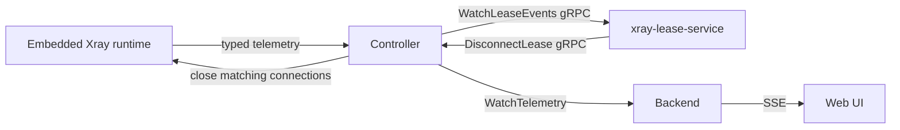

# План Xray lease-service

Статус: план подготовлен, реализация не начата.

## 1. Цель

Добавить для Xray-профилей временное ограничение на совместное использование одних и тех же учётных данных. Если один профиль одновременно используется из нескольких сетевых источников, сервис должен дать короткое окно для обычной смены сети, а затем закрыть самый старый lease и оставить самый новый.

AmneziaWG в этот механизм не входит. Для AmneziaWG сохраняется текущая модель: один профиль создаётся с отдельной key pair и идентифицируется public key peer’а.

## 2. Что именно защищаем

Xray идентифицирует пользователя UUID/паролем или другим протокольным credential. Если одна и та же ссылка скопирована на два устройства, Xray не получает криптографический идентификатор физического устройства. Поэтому lease в проекте является сетевым наблюдением, а не доказательством отдельного устройства.

В MVP lease определяется ключом:

```text
(xray protocol, profile email, source IP)
```

В один профиль могут входить несколько TCP/UDP-соединений. Они не считаются отдельными lease, если относятся к одному и тому же `(profile, protocol, source IP)`.

### Ограничения такой идентификации

- два устройства за одним NAT могут выглядеть как один lease;
- переход Wi-Fi ↔ LTE может создать новый lease;
- IPv4 и IPv6 одного устройства могут быть двумя lease;
- VPN, CGNAT и мобильные сети могут менять source IP без копирования профиля;
- source IP нельзя считать стабильным или секретным идентификатором устройства.

UI, audit и документация должны называть это обнаружением совместного использования профиля, а не гарантированным device binding.

## 3. Термины и временные параметры

| Термин | Значение |
| --- | --- |
| profile | Внутренний профиль устройства backend; для Xray используется его email и протокол |
| lease | Активное наблюдение профиля с одного source IP |
| `idle_timeout` | 15 секунд без наблюдаемой активности; совпадает с текущим Xray online window |
| `dual_lease_grace` | 30 секунд, в течение которых два lease допускаются временно |
| `max_active_leases` | 2 для первой версии |
| oldest lease | Lease с наименьшим `first_seen` среди активных lease |

Рекомендуемые значения по умолчанию:

```text
XRAY_LEASE_SERVICE_ENABLED=false
XRAY_LEASE_MAX_ACTIVE=2
XRAY_LEASE_GRACE=30s
XRAY_LEASE_IDLE_TIMEOUT=15s
```

Параметры не должны задаваться произвольными отрицательными или нулевыми значениями. Их валидация должна происходить в lease-service и в Doctor.

## 4. Точная семантика lease-flow

### 4.1 Первый lease

При появлении первого активного source IP сервис создаёт lease:

```text
first_seen = event time
last_activity = event time
state = active
```

Один активный lease не ограничивается по длительности. Пока поступает трафик, `last_activity` обновляется.

### 4.2 Второй lease

При появлении второго отличающегося source IP:

1. создаётся второй lease;
2. определяется самый старый lease по `first_seen`;
3. запускается deadline `second.first_seen + XRAY_LEASE_GRACE`;
4. до deadline оба lease могут работать.

Если один из lease становится offline раньше deadline, он удаляется из активного набора, таймер отменяется, оставшийся lease продолжает работу.

### 4.3 Истечение 30 секунд

Если к deadline оба lease всё ещё активны:

1. lease-service фиксирует `lease_conflict`;
2. выбирает lease с минимальным `first_seen`;
3. вызывает точечное закрытие соединений только этого lease;
4. помечает oldest lease как `terminated`;
5. оставляет второй, более новый lease активным;
6. не отзывает credential профиля и не затрагивает новый lease.

Это заменяет первоначальное решение «закрывать оба соединения». Разрыв должен быть адресным, иначе закрытие пользователя целиком нарушит требование.

### 4.4 Третий lease

При появлении третьего активного source IP набор превышает лимит в два lease. Рекомендуемое поведение:

1. зафиксировать конфликт без ожидания 30 секунд;
2. закрыть самый старый активный lease;
3. оставить два самых новых lease;
4. для оставшихся двух запустить новый `dual_lease_grace`.

Таким образом, сервис всегда удерживает не более двух активных lease и предпочитает более новые источники. Если продукт решит применять 30-секундное окно и к третьему lease, это должно быть отдельной настройкой, а не скрытым изменением семантики.

### 4.5 Offline и повторное подключение

- lease считается offline, если `now - last_activity > idle_timeout`;
- offline lease удаляется из активного набора, но остаётся в короткой истории для диагностики;
- повторное появление того же source IP создаёт новый lease с новым `first_seen`;
- старый lease не должен воскресать из кеша после перезапуска сервиса;
- после рестарта состояние восстанавливается из текущего полного telemetry snapshot, а не из старых lease.

## 5. Архитектура



`xray-lease-service` — отдельный внутренний контейнер без опубликованных портов. Он постоянно подключается к Controller, а не запускается только при наличии Web UI/SSE-подписки.

### Почему lease-service должен быть отдельным

- lease enforcement должен работать без открытой панели;
- backend не должен содержать сетевую state machine и таймеры блокировок;
- Controller остаётся адаптером между сервисами и предоставляет нормализованный источник событий;
- сервис можно перезапустить независимо от Xray и backend;
- позднее можно добавить другие policy services без изменения Xray runtime.

## 6. Изменения Controller

### 6.1 Общий telemetry hub

Сейчас каждый `WatchTelemetry` подписчик может создать отдельный upstream stream к Xray Runtime. После добавления постоянного lease-service одновременно будут работать как минимум backend и lease-service.

Нужно вынести сбор телеметрии в Controller-owned hub:

- один upstream stream к Xray Runtime;
- один upstream stream к AWG, если AWG включён;
- кэш последнего полного snapshot;
- подписчики получают latest-wins обновления без накопления очереди;
- медленный подписчик не блокирует runtime collector;
- backend и lease-service используют разные представления одного snapshot.

AWG данные проходят через hub только для общей инфраструктуры. Lease policy фильтрует и обрабатывает только Xray-протоколы.

### 6.2 Новый lease event contract

Добавить в Controller protobuf отдельный server-streaming RPC:

```protobuf
rpc WatchLeaseEvents(WatchLeaseEventsRequest)
    returns (stream LeaseEvent);
```

Минимальный контракт:

```protobuf
message WatchLeaseEventsRequest {
  uint32 sample_interval_ms = 1;
}

enum LeaseEventType {
  LEASE_EVENT_TYPE_UNSPECIFIED = 0;
  LEASE_ONLINE = 1;
  LEASE_ACTIVITY = 2;
  LEASE_OFFLINE = 3;
  LEASE_SOURCE_CHANGED = 4;
  LEASE_SOURCE_UNAVAILABLE = 5;
}

message LeaseEvent {
  string profile_email = 1;
  string protocol = 2;
  string source_ip = 3;
  LeaseEventType type = 4;
  google.protobuf.Timestamp observed_at = 5;
  google.protobuf.Timestamp last_activity = 6;
  int64 upload_bytes = 7;
  int64 download_bytes = 8;
  string source_generation = 9;
  uint64 source_sequence = 10;
}
```

Секреты, UUID и полные профили в event payload не передаются. `profile_email` является внутренним идентификатором Xray и не должен попадать в публичные логи.

### 6.3 Source observations

Текущий runtime знает source IP и `last_seen`, но Controller частично упрощает эту информацию до массива строк. Для lease-flow нужно сохранить наблюдения с временем:

```protobuf
message SourceObservation {
  string address = 1;
  google.protobuf.Timestamp last_seen = 2;
}
```

Runtime response и Controller event adapter должны передавать список таких наблюдений. Источником offline-события остаётся Controller/runtime policy с окном 15 секунд; lease-service не должен самостоятельно вводить второе несовместимое окно.

### 6.4 RPC для точечного закрытия

Добавить в Controller:

```protobuf
rpc DisconnectLease(DisconnectLeaseRequest)
    returns (DisconnectLeaseResponse);
```

```protobuf
message DisconnectLeaseRequest {
  string protocol = 1;
  string profile_email = 2;
  string source_ip = 3;
  string operation_id = 4;
}

message DisconnectLeaseResponse {
  bool already_disconnected = 1;
  uint32 closed_connections = 2;
}
```

`operation_id` нужен для идемпотентности после временного обрыва gRPC. Повтор той же операции не должен закрывать уже новый lease с тем же source IP.

Controller проверяет:

- корректность protocol/email/source IP;
- текущую revision/generation runtime;
- что операция не устарела;
- права вызывающего lease-service identity.

## 7. Изменения embedded Xray runtime

### 7.1 Почему `RemoveUser` недостаточно

Удаление пользователя из Xray `UserManager` запрещает новые аутентификации, но не даёт гарантированного адресного закрытия уже установленных соединений. Оно также не позволяет закрыть только oldest lease и оставить newest.

### 7.2 Реестр активных соединений

В runtime потребуется внутренний connection registry:

```text
key: protocol + user email + source IP
value: set of active connection handles
```

Для каждого соединения нужно:

1. определить пользователя после успешной аутентификации;
2. получить remote source IP;
3. зарегистрировать closable handle;
4. удалить handle при штатном завершении или ошибке;
5. закрывать все handles по ключу `DisconnectLease`.

Регистрация не должна выполняться для неаутентифицированных или отклонённых соединений.

### 7.3 Точки интеграции

Сначала проверить, можно ли безопасно обернуть connection lifecycle через доступные интерфейсы Xray-core. Если после аутентификации upstream не передаёт user identity во внешний hook, потребуется один из вариантов:

1. небольшой patch/fork закреплённой версии Xray-core;
2. собственная регистрация inbound implementation для поддерживаемых протоколов;
3. fallback только на блокировку новых подключений.

Собственный fork допустим только после документированного spike и тестов на точной версии Xray-core. Нельзя объявлять `DisconnectLease` работающим, если runtime закрывает только будущие подключения.

### 7.4 Требования к close

- закрытие должно быть идемпотентным;
- закрытие одного lease не должно затрагивать второй source IP;
- новые соединения этого lease после close должны отклоняться до следующей разрешённой политики;
- close не должен блокировать Xray event loop;
- graceful close должен иметь короткий deadline, после которого соединение закрывается принудительно;
- counters и telemetry должны корректно перейти в offline после close.

## 8. Реализация lease-service

### 8.1 Внутренние компоненты

1. `controller client` — аутентифицированный reconnecting gRPC client;
2. `event normalizer` — проверка порядка generation/sequence;
3. `lease store` — in-memory state machine с fake clock в тестах;
4. `deadline scheduler` — отдельные таймеры dual lease;
5. `enforcement client` — идемпотентный `DisconnectLease`;
6. `audit/logger` — structured logs без секретов;
7. `health server` — внутренний healthcheck для Compose и Doctor.

### 8.2 Обработка порядка событий

Controller должен передавать generation и sequence. Lease-service:

- принимает только события текущего generation;
- игнорирует sequence, старше последнего обработанного;
- очищает state при смене generation;
- после gap или reconnect ждёт полный snapshot;
- не запускает close по неполному snapshot без подтверждённой доступности источника.

### 8.3 Reconnect

- stream открывается с backoff и jitter;
- после Controller restart сервис переподключается автоматически;
- старые timers отменяются при смене generation;
- текущие Xray sessions не закрываются из-за временной недоступности telemetry;
- при недоступности Controller lease enforcement переходит в fail-open и сообщает состояние через health/Doctor.

### 8.4 Fail-open policy

Рекомендуемый режим для MVP — fail-open:

- при сбое lease-service не разрывать существующие VPN-сессии;
- не удалять пользователей массово;
- разрешить нормальную работу Xray;
- вывести предупреждение в Doctor и structured logs;
- после восстановления начать с полного snapshot.

Fail-closed должен быть отдельной осознанной настройкой, потому что падение Controller не должно случайно отключать всех пользователей.

## 9. Compose и токены

### 9.1 Сервис

Добавить:

```yaml
xray-lease-service:
  profiles: ["lease"]
  restart: unless-stopped
  networks:
    - control
  depends_on:
    controller:
      condition: service_healthy
    xray-core-service:
      condition: service_healthy
```

Сервис не имеет `ports`, `devices`, доступа к `/data` или к SQLite.

### 9.2 Отдельная identity

Не монтировать в lease-service общий backend token. Добавить отдельный init service и volume:

```text
lease-auth-init
lease_controller_token_data
```

Controller должен различать identity и разрешать lease-service только:

- `WatchLeaseEvents`;
- `DisconnectLease`;
- `Health`/capabilities.

Доступ к настройкам, профилям, backup и административным RPC запрещён.

### 9.3 Compose profiles

Текущий installer перезаписывает `COMPOSE_PROFILES` при настройке AWG. Нужно вынести объединение профилей в общий helper, чтобы поддерживать комбинации:

```text
""
"awg"
"lease"
"awg,lease"
```

Helper должен:

- читать существующие профили;
- добавлять/удалять один профиль;
- сортировать результат в стабильном порядке;
- удалять дубликаты;
- не уничтожать неизвестные будущие профили;
- корректно обрабатывать пустое значение.

## 10. Изменения установщика

### 10.1 TUI

Добавить экран после настроек протоколов:

```text
Xray lease protection

1. Disabled
2. Enabled
```

По умолчанию `Disabled`.

На существующей установке значение читается из `.env` и сохраняется, если пользователь не изменил его. На финальном экране показывать:

```text
Lease service: enabled
Maximum active leases: 2
Conflict grace period: 30s
Offline timeout: 15s
```

Для первой версии installer не должен позволять включить сервис, если текущий образ/checkout не содержит рабочий `xray-lease-service` и его healthcheck. Нельзя записать флаг, который заведомо приведёт к неработающему Compose.

### 10.2 `.env`

Новая чистая установка записывает:

```dotenv
XRAY_LEASE_SERVICE_ENABLED=false
XRAY_LEASE_MAX_ACTIVE=2
XRAY_LEASE_GRACE=30s
XRAY_LEASE_IDLE_TIMEOUT=15s
```

При включении установщик добавляет профиль `lease` в `COMPOSE_PROFILES`.

### 10.3 Upgrade/disable

При отключении существующей установки:

1. записать `XRAY_LEASE_SERVICE_ENABLED=false`;
2. удалить `lease` из `COMPOSE_PROFILES`;
3. остановить старый `xray-lease-service`, если он запущен;
4. выполнить Compose с `--remove-orphans`;
5. не удалять lease state и audit из volume, если они появятся позднее.

При включении:

1. проверить Compose config;
2. убедиться, что Controller и runtime healthy;
3. запустить lease-service;
4. дождаться его healthcheck;
5. выполнить Doctor.

## 11. Doctor и диагностика

Добавить проверки:

- lease flag и effective Compose profile согласованы;
- lease-service container healthy;
- lease-service подключён к Controller;
- Controller принимает lease identity;
- runtime поддерживает `DisconnectLease`;
- параметры `max_active`, `grace`, `idle_timeout` валидны;
- текущий generation/sequence telemetry не устарел.

Предлагаемые результаты:

```text
PASS  Xray lease service: enabled and healthy
PASS  Xray lease stream: Controller connection is authenticated
PASS  Xray lease enforcement: DisconnectLease is supported
WARN  Xray lease service: disabled by configuration
WARN  Xray lease service: telemetry stream is temporarily unavailable
FAIL  Xray lease service: enabled but container is unhealthy
FAIL  Xray lease enforcement: runtime supports blocking only, not connection close
```

Логи должны содержать только:

- operation ID;
- protocol;
- redacted internal profile ID;
- source IP — только если это уже разрешено текущей политикой логирования;
- lease state transition;
- age/deadline;
- результат close и количество закрытых соединений.

Не логировать UUID, passwords, profile links, private keys и полные protobuf payloads.

## 12. Backend и Web UI

В первой версии lease-service не должен менять backend API и не должен зависеть от SSE. Backend продолжает получать обычную telemetry для отображения статуса.

После стабилизации enforcement можно добавить в Web UI:

- текущие активные lease;
- source IP и время первого наблюдения;
- countdown dual-lease grace;
- факт закрытия oldest lease;
- кнопку «сбросить lease state»;
- настройку включения policy без изменения Compose.

Это отдельный этап. До него UI показывает только обычный online/source status.

## 13. Тестовый план

### 13.1 Lease state machine

Покрыть unit-тестами:

- первый lease;
- второй lease запускает deadline;
- второй lease offline до deadline отменяет действие;
- deadline закрывает только oldest;
- newest остаётся active;
- третий lease закрывает oldest и оставляет два новых;
- одинаковый source IP не создаёт второй lease;
- повторное событие не создаёт дубликат;
- stale sequence игнорируется;
- смена generation очищает transient state;
- idle timeout ровно на границе 15 секунд;
- timer cancellation и повторный запуск;
- Controller reconnect;
- fail-open при недоступном enforcement.

### 13.2 Runtime

- несколько соединений одного lease закрываются вместе;
- соединения второго source IP не закрываются;
- закрытие уже завершённого lease идемпотентно;
- новый connection после close не регистрируется как старый handle;
- ошибочный/неаутентифицированный connection не попадает в registry;
- concurrent register/close безопасны под race detector;
- counters и online status становятся offline после закрытия.

### 13.3 Controller

- authentication lease identity;
- ACL для lease RPC;
- generation/sequence ordering;
- event conversion из runtime source observations;
- reconnect upstream runtime;
- multiple subscribers через общий hub;
- latest-wins backpressure;
- `DisconnectLease` revision fence и idempotency.

### 13.4 Installer

- новая установка сохраняет disabled;
- включение сохраняет `XRAY_LEASE_SERVICE_ENABLED=true`;
- комбинации `awg`, `lease`, `awg,lease`;
- повторный запуск не дублирует профили;
- отключение удаляет только `lease`;
- неизвестные Compose profiles сохраняются;
- существующий `.env` и master key не заменяются;
- старый стек без lease продолжает устанавливаться;
- чистая установка с включённым lease запускает healthy service.

### 13.5 Integration/runtime stack

Добавить сценарии:

1. Controller restart и восстановление lease stream;
2. Xray runtime restart и generation reset;
3. второй source IP → 30 секунд → закрывается только старый lease;
4. третий source IP → закрывается oldest;
5. close failure не закрывает newest и попадает в Doctor/logs;
6. lease-service restart без массового отключения пользователей.

## 14. Порядок коммитов

Каждый этап фиксируется отдельным коммитом:

1. `docs: record xray lease service plan` — этот документ;
2. `proto: add lease events and disconnect lease contract`;
3. `runtime: track and disconnect xray lease connections`;
4. `controller: add telemetry hub and lease event stream`;
5. `lease: add lease state machine and enforcement service`;
6. `compose: add optional lease service and dedicated token`;
7. `installer: add lease service toggle and profile merging`;
8. `doctor: validate lease service and enforcement capability`;
9. `test: add lease integration and installer coverage`;
10. `docs: document lease configuration and troubleshooting`.

Перед каждым переходом к следующему этапу должны проходить релевантные unit, race, coverage и Compose checks.

## 15. Критерии готовности

Функция считается готовой, когда:

- AmneziaWG не изменён и продолжает работать прежним способом;
- lease-service можно включить/выключить через installer;
- сервис не имеет публичного порта;
- lease stream работает независимо от Web UI/SSE;
- один профиль с одним source IP работает без ограничений по времени;
- второй source IP получает 30-секундное grace window;
- по истечении окна закрывается только oldest lease;
- newest lease продолжает работу;
- третий lease не оставляет более двух активных lease;
- Controller и runtime переживают перезапуск без массового disconnect;
- Doctor различает disabled, unavailable и unsupported enforcement;
- все gRPC операции аутентифицированы, идемпотентны и имеют operation ID;
- нет утечек секретов в логах и telemetry payloads;
- тесты покрывают state machine, runtime close, Controller, Compose и installer.

## 16. Риски и открытые решения

1. **Source IP — эвристика.** Нужно явно показать это в UI и README.
2. **Точечное закрытие может потребовать fork Xray-core.** Сначала провести spike на закреплённой версии, затем выбрать hook или fork.
3. **IPv4/IPv6 одного устройства могут создать два lease.** Нужно решить, считать ли dual-stack переход отдельным lease или добавить короткое окно объединения адресов.
4. **Третий lease.** В этом плане выбран немедленный close oldest и сохранение двух новых; решение должно быть подтверждено до реализации.
5. **Сбой enforcement.** В этом плане выбран fail-open; fail-closed не должен включаться неявно.
6. **Перезапуск lease-service.** Transient lease timers не сохраняются; после рестарта сервис начинает с полного snapshot, чтобы не закрыть новый lease по устаревшему таймеру.

