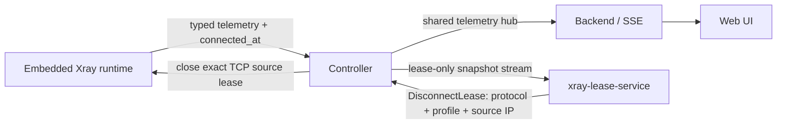

# Xray lease-service: план и состояние реализации

Обновлено: 2026-10-03. Локальная реализация завершена; сервис выключен по
умолчанию. Перед включением на рабочем VDS нужно пройти ручную проверку из
раздела 9.

## 1. Цель и выбранная семантика

Опциональный `xray-lease-service` ограничивает одновременное использование
одного Xray-профиля с разных source IP. Один профиль может иметь не более двух
активных source-IP leases:

- первый источник продолжает работу без ограничения времени;
- после появления второго оба работают в течение 30 секунд; если к концу
  окна оба всё ещё активны, закрывается только более старый;
- третий источник приводит к немедленному закрытию самого старого; остаются
  два более новых;
- AmneziaWG не участвует в этой политике.

Lease идентифицируется как `(protocol, profile email, canonical source IP)`.
Это ограничение совместного использования по сетевому адресу, а не привязка к
физическому устройству. Два устройства за одним NAT выглядят как один lease;
одно устройство при смене Wi-Fi/LTE или IPv4/IPv6 может выглядеть как два.

## 2. Актуальная архитектура и ограничения

- Xray работает как embedded instance внутри `xray-core-service`; внешнего
  процесса Xray и его административного gRPC API нет.
- Runtime получает authenticated inbound session из Xray dispatch и хранит
  closable parent connection по протоколу, email и source IP. `DisconnectLease`
  закрывает соединения ровно этого ключа, не удаляя пользователя.
- Точное закрытие включено только для TCP VLESS, VMess и Trojan. VLESS прошёл
  integration test с двумя одновременными source IP: закрытие одного оставляет
  второй активным. VMess и Trojan используют тот же runtime hook и покрыты
  тестами извлечения lease identity, но требуют ручной проверки на VDS.
- Hysteria 2, Shadowsocks UDP и AmneziaWG исключены. Добавлять их можно только
  после отдельного теста, подтверждающего точечное закрытие активного клиента.
- Key registry хранит время начала непрерывного source-IP lease. Controller
  передаёт `connected_at`, чтобы после рестарта lease-service порядок oldest
  не зависел от порядка IP в snapshot. Xray restart завершает сессии и создаёт
  новый runtime generation.
- Источник online/offline — существующая Xray telemetry policy: user считается
  online, пока его traffic counters продвигаются в текущем 15-секундном окне.
  Это окно действует на весь профиль, а не отдельно на каждый source IP. Поэтому
  открытое, но простаивающее соединение одного IP может оставаться в lease
  snapshot, пока другой источник того же профиля продолжает передавать трафик.
  В проекте нет независимого точного per-source idle timer; lease-service не
  должен выдавать профильный 15-секундный признак за per-source disconnect.
- Controller держит общий telemetry hub с latest-wins fanout. Он открывается,
  пока есть хотя бы один subscriber: Web/SSE или lease-service. Enforcement не
  зависит от открытого Web UI; при выключенном lease profile остаётся только
  прежнее поведение backend telemetry.
- Lease-service использует отдельный Controller token. ACL разрешает только
  `Health`, `GetCapabilities`, `WatchLeaseSnapshots` и `DisconnectLease`.
  Сервис не имеет опубликованных портов, доступа к `/data`, SQLite или общему
  backend token.

## 3. Поток данных

## 4. Реализация по этапам

### Этап 1. Проверка runtime interception и точечного disconnect — реализовано

- Оборачивать outbound dispatch embedded Xray, сохраняя исходные handlers и
  специализированные connection interfaces.
- После аутентификации регистрировать parent connection, protocol, profile
  email и нормализованный source IP; освобождать запись после завершения
  dispatch.
- Сделать disconnect адресным, идемпотентным по operation ID и безопасным при
  одновременном register/close. Не удалять профиль и не закрывать соседний IP.
- Проверить реальный параллельный VLESS сценарий. Точечное закрытие подтверждено
  integration test; ручные VMess/Trojan клиентские тесты остаются в этапе 8.

### Этап 2. Typed runtime и Controller contracts, auth и revisions — реализовано

- Добавить typed protobuf `DisconnectLease` и `connected_at` для source
  observations.
- Пропустить disconnect через Controller с generation fencing, проверкой
  protocol/profile/IP и отдельной lease identity.
- Ограничить lease identity allowlist RPC и покрыть его аутентификацию тестами.

### Этап 3. Общий Controller telemetry hub — реализовано

- Один upstream telemetry stream на источник для всех подписчиков Controller.
- Latest-wins fanout и отмена upstream при отсутствии подписчиков.
- Использовать одинаковые typed telemetry snapshots для Web/SSE и lease policy;
  не создавать отдельный polling path.

### Этап 4. Lease policy worker — реализовано

- Реализовать тестируемую state machine с generation/sequence fencing, полными
  snapshots, фиксированным лимитом 2, grace 30s, немедленным enforcement при
  третьем IP, повтором временно неудавшегося RPC и fail-open при потере Controller.
- Выбирать oldest по `connected_at`, а не порядку массива. После перезапуска
  worker восстанавливает source order из активного runtime snapshot. Если два
  lease уже существуют при старте worker, для их проверки начинается новое
  grace-окно; рестарт policy не должен неожиданно обрывать активную сессию.
- Стабильный operation ID сохраняется при неопределённом исходе RPC; новый
  generation сбрасывает старые operation IDs. Для определённого `Internal`
  ответа используется новый ID: runtime может кэшировать результат неудачного
  close под прежним ID, и его повтор без нового ID не дал бы повторить операцию.
- Логи содержат protocol, хешированный внутренний profile ID, source IP,
  operation ID и исход disconnect; секреты и полные protobuf payload не пишутся.

### Этап 5. Отдельный optional container и ограниченный доступ — реализовано

- Добавить `xray-lease-service` в Compose под profile `lease`, выключенный по
  умолчанию, без published ports и с внутренним `/healthz`.
- Создавать отдельный token в отдельном volume; Controller принимает его только
  для lease allowlist RPC.
- Включить сервис в сборку образов CI и использовать non-root/read-only
  настройки контейнера.

### Этап 6. Installer и Doctor — реализовано и проверено локально

- Добавить выбор включения lease-service в TUI, по умолчанию выключенный.
- Сохранять `XRAY_LEASE_SERVICE_ENABLED` и объединять Compose profiles, не
  удаляя `awg` или неизвестные сторонние profiles.
- Валидировать лимит/grace/retry до запуска Compose. Отключение удаляет только
  профиль `lease`; данные остальных сервисов не меняются.
- Doctor проверяет enabled service health и состояние Controller stream; на
  чистой установке до первой настройки показывает WARN.
- Doctor считает сервис включённым как по `XRAY_LEASE_SERVICE_ENABLED=true`, так
  и по наличию `lease` в `COMPOSE_PROFILES`; это покрыто unit-тестом.
- Installer, policy validation, Doctor health probe и обнаружение Compose
  profile покрыты unit-тестами. `docker compose config --quiet` проходит без
  optional profile, с `lease` и с комбинацией `awg,lease`.

### Этап 7. Документация — реализовано

- Синхронизировать README и 10 переводов: Compose profile, ограничения
  протоколов, NAT/IP caveat, включение из установщика, диагностика и образ.
- Уточнить `.env.example`: нет per-source idle timeout; используется общий
  профильный Xray online window в 15 секунд.

### Этап 8. Локальная проверка — выполнено, кроме сборки контейнерного образа

- Go tests для root module и nested `xray-runtime` прошли. Runtime integration
  test выполнен с loopback bind и подтвердил точечное отключение VLESS lease.
- Race detector прошёл для `internal/lease`, `internal/controller` и
  `xray-runtime/internal/runtime`.
- Backend handwritten coverage: 90.0% в целом; каждый пакет выше CI-порога 80%.
- Godoc checker и Compose config validation прошли; installer transitions и
  Doctor lease-проверки покрыты unit-тестами.
- Docker image build/start в локальной среде не проверены: Docker daemon
  недоступен. Сборку и запуск нужно выполнить на VDS вместе с ручными
  пользовательскими сценариями этапа 9.

### Этап 9. Ручная проверка на VDS — ожидает владельца установки

1. Установить обновление, оставить lease выключенным, проверить обычные VLESS,
   VMess и Trojan подключения.
2. Включить Lease protection в `install.sh`; выполнить `docker compose ps` и
   Doctor. Убедиться, что `xray-lease-service` healthy и отдельный порт не
   опубликован.
3. Одним профилем подключить первое устройство и убедиться, что оно не
   отключается. Подключить второе с другого публичного IP; проверить, что оба
   работают в течение 30 секунд, после чего остаётся второе, а первое
   отключается.
4. Подключить третий source IP: должен быть отключён самый старый, а два новых
   остаются подключёнными.
5. Проверить, что повторное подключение из того же source IP не создаёт lease;
   проверить особенности NAT, смену сети и IPv4/IPv6 как разные source IP.
6. Перезапустить lease-service и Controller при двух активных IP; worker должен
   восстановить connected order по `connected_at`, переподключиться и не закрыть
   неправильный lease. Перезапустить Xray runtime отдельно: его соединения
   завершатся обычным runtime restart.
7. Временно остановить Controller/runtime: сервис должен работать fail-open,
   без массового сброса клиентов; после восстановления snapshots enforcement
   возобновляется.
8. Убедиться, что Hysteria 2, Shadowsocks UDP и AWG не затрагиваются; отключить
   lease в установщике и проверить удаление только Compose profile `lease`.

## 5. Настройки и поддерживаемый охват

| Переменная | Значение по умолчанию | Назначение |
| --- | --- | --- |
| `XRAY_LEASE_SERVICE_ENABLED` | `false` | Установщик сохраняет состояние; Compose profile `lease` включает сервис. |
| `XRAY_LEASE_MAX_ACTIVE` | `2` | В MVP фиксированная политика требует ровно 2. |
| `XRAY_LEASE_GRACE` | `30s` | Допустимый период с двумя source IP. |
| `XRAY_LEASE_RETRY_DELAY` | `1s` | Пауза перед повтором временно неудачного disconnect. |

Реализация принимает только `vless`, `vmess`, `trojan`; прочие protocol
identities отвергаются. Отдельной `XRAY_LEASE_IDLE_TIMEOUT` переменной нет.

## 6. Основные риски и принятые меры

- **Ошибочно закрыть соседнее соединение:** registry индексирован полным
  lease identity; integration test проверяет сохранение второго IP.
- **Неопределённый исход gRPC disconnect:** operation ID идемпотентен и
  generation-scoped.
- **Устаревший или неполный telemetry:** enforcement ждёт доступный полный
  snapshot и игнорирует старые sequence/generation.
- **Падение policy сервиса:** fail-open; существующие соединения остаются в
  Xray.
- **Несколько устройств за NAT:** они неразличимы; это явно описано как
  ограничение source-IP policy.
- **Простаивающее соединение:** профильный traffic activity может сохранять
  online статус source observations, пока другой source того же профиля активен.
  Это ограничение не маскируется per-source idle timer.
- **UDP и multiplex transports:** они исключены до подтверждения точного
  закрытия конкретной сессии тестами.

## 7. Проверяемые критерии готовности к VDS

- `go test` проходит в обоих Go modules; runtime integration tests проходят при
  разрешённом loopback bind.
- Race detector не выявляет гонок в registry, telemetry hub и lease worker.
- Go documentation checker проходит для нового production кода.
- Compose config валиден как без `lease`, так и с `COMPOSE_PROFILES=lease` и
  комбинацией `awg,lease`.
- Установщик сохраняет существующие master key, AWG настройки и сторонние
  Compose profiles при повторном включении/отключении lease.
- Doctor обнаруживает и healthy, и unhealthy lease service, включая случай,
  когда `COMPOSE_PROFILES` включает lease.
- VDS сценарии из этапа 9 завершены вручную до рекомендации включать механизм в
  рабочей установке.
